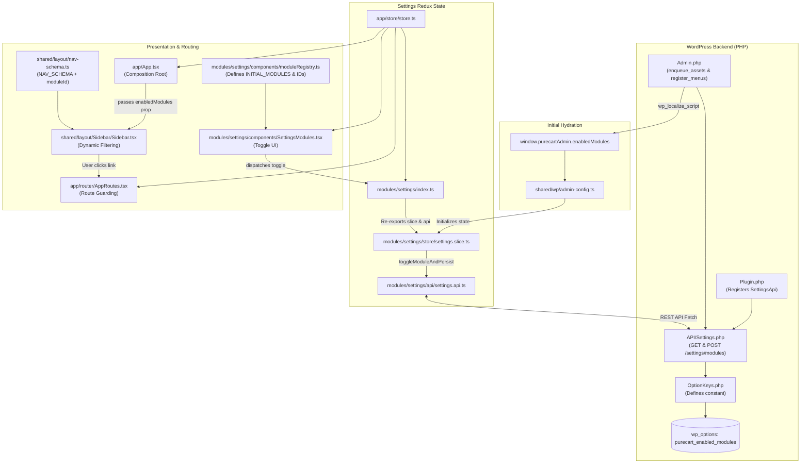

# PureCart — Feature Implementation Plan: Dynamic Module Enable/Disable & Sidebar Filtering

## Executive Summary

In PureCart, the dashboard provides a **Settings → Modules** tab allowing store administrators to toggle plugin feature modules (such as Subscriptions, License Manager, Secure Downloads, etc.) on or off. Currently, toggling a module only mutates local React component state; it has no effect on navigation or the main admin sidebar.

This plan details how to make module toggling functional:
1. **Disabling a module automatically hides it from the main admin sidebar (`Sidebar.tsx`)**.
2. **Re-enabling a module immediately displays it in the sidebar**.
3. **State is persistently stored in WordPress database options** via a dedicated REST API controller and hydrated into the frontend upon initial page load without layout shift or UI flickering.
4. **Disabled module routes are guarded**, redirecting users to the Overview page if they attempt to deep-link to a disabled module.

---

## 1. File Count & Summary

A total of **15 files** will be created or modified (4 PHP backend files and 11 TypeScript/React frontend files):

| # | File Path | Type | Action | Purpose |
|---|---|---|---|---|
| **1** | `includes/Settings/OptionKeys.php` | PHP | Modify | Add `ENABLED_MODULES` option key constant. |
| **2** | `includes/API/Settings.php` | PHP | **Create** | New REST API controller for `GET` and `POST /purecart/v1/settings/modules`. |
| **3** | `includes/Plugin.php` | PHP | Modify | Bootstrap and register the `Settings` API controller during plugin init. |
| **4** | `includes/Admin/Admin.php` | PHP | Modify | Localize `enabledModules` into `purecartAdmin` and filter WP admin submenus. |
| **5** | `src/app/shared/wp/admin-config.ts` | TypeScript | Modify | Add `enabledModules` to `PurecartAdminConfig` interface. |
| **6** | `src/app/modules/settings/components/moduleRegistry.ts` | TypeScript | Modify | Associate each module with its canonical `Page` route ID. |
| **7** | `src/app/modules/settings/api/settings.api.ts` | TypeScript | **Create** | Typed REST API client for fetching and saving module status. |
| **8** | `src/app/modules/settings/store/settings.slice.ts` | TypeScript | **Create** | Redux slice managing global module state, optimistic updates, and persistence thunks. |
| **9** | `src/app/modules/settings/index.ts` | TypeScript | Modify | Export slice reducers, selectors, and API methods at module boundary. |
| **10** | `src/app/store/store.ts` | TypeScript | Modify | Register `settingsReducer` in the root Redux store. |
| **11** | `src/app/shared/layout/nav-schema.ts` | TypeScript | Modify | Link each sidebar nav item to its required `moduleId`. |
| **12** | `src/app/shared/layout/Sidebar/Sidebar.tsx` | TypeScript | Modify | Filter navigation items based on `enabledModules` and adjust divider rules. |
| **13** | `src/app/modules/settings/components/SettingsModules.tsx` | TypeScript | Modify | Replace local state with Redux state and async persistence thunk. |
| **14** | `src/app/App.tsx` | TypeScript | Modify | Select `enabledModules` from Redux and pass down to `Sidebar`. |
| **15** | `src/app/router/AppRoutes.tsx` | TypeScript | Modify | Guard routes against accessing disabled modules. |

---

## 2. Changes for Each File (Add / Remove / Modify)

---

### File 1: `includes/Settings/OptionKeys.php`

#### Changes:
Add constant `ENABLED_MODULES` under a new or existing settings group.

#### Code Modifications:
```diff
--- a/includes/Settings/OptionKeys.php
+++ b/includes/Settings/OptionKeys.php
@@ -24,6 +24,15 @@ class OptionKeys {
 
+	// General Plugin Settings
+
+	/**
+	 * Map of enabled/disabled feature modules (module ID => boolean).
+	 *
+	 * @since 1.0.0
+	 * @var string
+	 */
+	public const ENABLED_MODULES = 'purecart_enabled_modules';
+
 	// Licensing module
 
 	/**
```

---

### File 2: `includes/API/Settings.php` *(New File)*

#### Changes:
Create a new REST API controller extending `PureCartApi`. Provides `GET /purecart/v1/settings/modules` and `POST /purecart/v1/settings/modules`.

#### Code to Create:
```php
<?php
declare( strict_types=1 );
/**
 * REST API controller for plugin settings and module activation management.
 *
 * @package PureCart\API
 */

namespace PureCart\API;

defined( 'ABSPATH' ) || exit;

use PureCart\Settings\OptionKeys;
use PureCart\Settings\Settings as PluginSettings;

/**
 * Settings and module management REST controller.
 *
 * @since 1.0.0
 */
class Settings extends PureCartApi {

	/**
	 * Default modules status map.
	 *
	 * @since 1.0.0
	 * @var array<string, bool>
	 */
	public const DEFAULT_MODULES = array(
		'downloads'      => true,
		'licenses'       => true,
		'updates'        => true,
		'subscriptions'  => true,
		'saas-accounts'  => true,
		'affiliates'     => true,
		'abandoned-cart' => true,
		'analytics'      => true,
		'security'       => true,
	);

	/**
	 * Register REST routes for plugin settings.
	 *
	 * @since 1.0.0
	 * @return void
	 */
	public function register_routes(): void {
		$ns   = PURECART_API_NAMESPACE;
		$base = 'settings';

		register_rest_route(
			$ns,
			$base . '/modules',
			array(
				array(
					'methods'             => \WP_REST_Server::READABLE,
					'callback'            => array( $this, 'get_modules' ),
					'permission_callback' => array( $this, 'permission_admin' ),
				),
				array(
					'methods'             => \WP_REST_Server::CREATABLE,
					'callback'            => array( $this, 'save_modules' ),
					'permission_callback' => array( $this, 'permission_admin' ),
					'args'                => array(
						'modules' => array(
							'type'        => 'object',
							'required'    => true,
							'description' => 'Key-value map of module ID to enabled boolean status.',
						),
					),
				),
			)
		);
	}

	/**
	 * GET /settings/modules
	 *
	 * @since 1.0.0
	 * @return \WP_REST_Response
	 */
	public function get_modules(): \WP_REST_Response {
		$modules = self::get_enabled_modules();
		return rest_ensure_response( array( 'modules' => $modules ) );
	}

	/**
	 * POST /settings/modules
	 *
	 * @since 1.0.0
	 * @param \WP_REST_Request $request REST request.
	 * @return \WP_REST_Response
	 */
	public function save_modules( \WP_REST_Request $request ): \WP_REST_Response {
		$new_modules = $request->get_param( 'modules' );

		if ( ! is_array( $new_modules ) ) {
			return new \WP_REST_Response( array( 'message' => 'Invalid modules payload' ), 400 );
		}

		$current   = self::get_enabled_modules();
		$sanitized = array();

		foreach ( self::DEFAULT_MODULES as $key => $default_val ) {
			if ( array_key_exists( $key, $new_modules ) ) {
				$sanitized[ $key ] = (bool) $new_modules[ $key ];
			} else {
				$sanitized[ $key ] = $current[ $key ] ?? $default_val;
			}
		}

		PluginSettings::set( OptionKeys::ENABLED_MODULES, $sanitized );

		// Keep Subscriptions module flag in sync with OptionKeys::SUB_ENABLED
		if ( isset( $sanitized['subscriptions'] ) ) {
			PluginSettings::set( OptionKeys::SUB_ENABLED, $sanitized['subscriptions'] );
		}

		return rest_ensure_response(
			array(
				'success' => true,
				'modules' => $sanitized,
			)
		);
	}

	/**
	 * Helper to get enabled modules with defaults.
	 *
	 * @since 1.0.0
	 * @return array<string, bool>
	 */
	public static function get_enabled_modules(): array {
		$saved = PluginSettings::get( OptionKeys::ENABLED_MODULES, array() );
		if ( ! is_array( $saved ) ) {
			$saved = array();
		}
		return array_merge( self::DEFAULT_MODULES, $saved );
	}

	/**
	 * Permission check: current user can manage_options.
	 *
	 * @since 1.0.0
	 * @return bool
	 */
	public function permission_admin(): bool {
		return current_user_can( 'manage_options' );
	}
}
```

---

### File 3: `includes/Plugin.php`

#### Changes:
Instantiate and wire `\PureCart\API\Settings` in `Plugin::init()`.

#### Code Modifications:
```diff
--- a/includes/Plugin.php
+++ b/includes/Plugin.php
@@ -25,6 +25,7 @@ use PureCart\Updates\Module as UpdatesModule;
 use PureCart\SaaS\Module as SaasModule;
+use PureCart\API\Settings as SettingsApi;
 use PureCart\CLI\LicenseCommands;
 use PureCart\CLI\SaasCommands;
 
@@ -88,6 +89,7 @@ final class Plugin {
 		new SubscriptionsModule();
 		new UpdatesModule();
 		new SaasModule();
+		( new SettingsApi() )->register();
 
 		if ( is_admin() ) {
 			new Admin();
```

---

### File 4: `includes/Admin/Admin.php`

#### Changes:
1. In `register_menus()`: Check module enabled status so WP admin submenu items also reflect disabled modules.
2. In `enqueue_assets()`: Add `enabledModules` to the `purecartAdmin` localized object.

#### Code Modifications:
```diff
--- a/includes/Admin/Admin.php
+++ b/includes/Admin/Admin.php
@@ -19,6 +19,7 @@ defined( 'ABSPATH' ) || exit;
 
+use PureCart\API\Settings as SettingsApi;
+
 /**
  * Admin panel: menus, asset enqueue, settings.
@@ -97,8 +98,24 @@ class Admin {
 			array( 'purecart-settings', __( 'Settings', 'purecart' ), 'manage_options' ),
 		);
 
+		$enabled_modules = SettingsApi::get_enabled_modules();
+		$slug_to_module = array(
+			'purecart-licenses'       => 'licenses',
+			'purecart-downloads'      => 'downloads',
+			'purecart-updates'        => 'updates',
+			'purecart-subscriptions'  => 'subscriptions',
+			'purecart-saas-accounts'  => 'saas-accounts',
+			'purecart-affiliates'     => 'affiliates',
+			'purecart-abandoned-cart' => 'abandoned-cart',
+			'purecart-security'       => 'security',
+			'purecart-analytics'      => 'analytics',
+		);
+
 		foreach ( $nav_items as list($slug, $label, $capability) ) {
+			if ( isset( $slug_to_module[ $slug ] ) && empty( $enabled_modules[ $slug_to_module[ $slug ] ] ) ) {
+				continue;
+			}
 			add_submenu_page(
 				'purecart-dashboard',
 				/* translators: %s = module name */
@@ -181,6 +198,7 @@ class Admin {
 				'currentPage' => $current_page,
 				'version'     => PURECART_VERSION,
 				'currentUser' => $this->current_user_payload(),
+				'enabledModules' => SettingsApi::get_enabled_modules(),
 			)
 		);
```

---

### File 5: `src/app/shared/wp/admin-config.ts`

#### Changes:
Add `enabledModules?: Record<string, boolean>;` to `PurecartAdminConfig`.

#### Code Modifications:
```diff
--- a/src/app/shared/wp/admin-config.ts
+++ b/src/app/shared/wp/admin-config.ts
@@ -43,6 +43,7 @@ export interface PurecartAdminConfig {
 	adminUrl?: string;
 	version?: string;
 	currentUser?: PurecartCurrentUser;
+	enabledModules?: Record< string, boolean >;
 }
 
 declare global {
```

---

### File 6: `src/app/modules/settings/components/moduleRegistry.ts`

#### Changes:
Add `id: Page` property to `PluginModule` and assign each item in `INITIAL_MODULES` its corresponding route ID.

#### Code Modifications:
```diff
--- a/src/app/modules/settings/components/moduleRegistry.ts
+++ b/src/app/modules/settings/components/moduleRegistry.ts
@@ -28,8 +28,11 @@
+import type { Page } from '@/shared/types/page';
+
 export interface PluginModule {
+	id: Page;
 	name: string;
 	desc: string;
 	phase: string;
 	enabled: boolean;
 }
 
 export const INITIAL_MODULES: PluginModule[] = [
 	{
+		id: 'downloads',
 		name: 'Secure Downloads',
 		desc: 'Protect download links with expiring tokens',
 		phase: 'Phase 1',
 		enabled: true,
 	},
 	{
+		id: 'licenses',
 		name: 'License Manager',
 		desc: 'Issue and validate software licenses',
 		phase: 'Phase 1',
 		enabled: true,
 	},
 	{
+		id: 'updates',
 		name: 'Update Manager',
 		desc: 'Serve plugin/theme update packages',
 		phase: 'Phase 1',
 		enabled: true,
 	},
 	{
+		id: 'subscriptions',
 		name: 'Subscriptions',
 		desc: 'Recurring billing and subscription management',
 		phase: 'Phase 1',
 		enabled: true,
 	},
 	{
+		id: 'saas-accounts',
 		name: 'SaaS Provisioning',
 		desc: 'Automated account and seat management',
 		phase: 'Phase 2',
 		enabled: true,
 	},
 	{
+		id: 'affiliates',
 		name: 'Affiliate Program',
 		desc: 'Track referrals and manage commissions',
 		phase: 'Phase 2',
 		enabled: true,
 	},
 	{
+		id: 'abandoned-cart',
 		name: 'Abandoned Cart',
 		desc: 'Recover lost sales with automated emails',
 		phase: 'Phase 2',
 		enabled: true,
 	},
 	{
+		id: 'analytics',
 		name: 'Analytics',
 		desc: 'Advanced reporting and revenue dashboards',
 		phase: 'Phase 1',
 		enabled: true,
 	},
 	{
+		id: 'security',
 		name: 'Security Suite',
 		desc: 'Fraud detection and IP blocking',
 		phase: 'Phase 3',
 		enabled: true,
 	},
 ];
```

---

### File 7: `src/app/modules/settings/api/settings.api.ts` *(New File)*

#### Changes:
Typed REST API client for module settings.

#### Code to Create:
```ts
/**
 * Settings Module API Client.
 *
 * Typed wrappers for includes/API/Settings.php's admin routes
 * (GET/POST /purecart/v1/settings/modules).
 *
 * @file
 * @since 1.0.0
 */

import { purecartFetch } from '@/shared/api';

export interface ModulesResponse {
	modules: Record< string, boolean >;
}

/**
 * GET /purecart/v1/settings/modules
 *
 * @since 1.0.0
 * @return {Promise<Record<string, boolean>>}
 */
export async function fetchModulesSettings(): Promise< Record< string, boolean > > {
	const res = await purecartFetch< ModulesResponse >( '/settings/modules' );
	return res.modules;
}

/**
 * POST /purecart/v1/settings/modules
 *
 * @since 1.0.0
 * @param {Record<string, boolean>} modules Updated module flags.
 * @return {Promise<Record<string, boolean>>}
 */
export async function saveModulesSettings(
	modules: Record< string, boolean >
): Promise< Record< string, boolean > > {
	const res = await purecartFetch< ModulesResponse >( '/settings/modules', {
		method: 'POST',
		data: { modules },
	} );
	return res.modules;
}
```

---

### File 8: `src/app/modules/settings/store/settings.slice.ts` *(New File)*

#### Changes:
Redux slice for settings, managing enabled module statuses and async persistence.

#### Code to Create:
```ts
/**
 * Redux Slice for Plugin Settings & Module Activation.
 *
 * @file
 * @since 1.0.0
 */

import { createSlice, createAsyncThunk, PayloadAction } from '@reduxjs/toolkit';
import { getAdminConfig } from '@/shared/wp';
import type { Page } from '@/shared/types/page';
import { INITIAL_MODULES } from '../components/moduleRegistry';
import { saveModulesSettings } from '../api/settings.api';

export interface SettingsState {
	modules: Record< string, boolean >;
	isSaving: boolean;
	error: string | null;
}

const buildInitialModules = (): Record< string, boolean > => {
	const localized = getAdminConfig().enabledModules;
	if ( localized && Object.keys( localized ).length > 0 ) {
		return localized;
	}
	const defaults: Record< string, boolean > = {};
	INITIAL_MODULES.forEach( ( m ) => {
		defaults[ m.id ] = m.enabled;
	} );
	return defaults;
};

const initialState: SettingsState = {
	modules: buildInitialModules(),
	isSaving: false,
	error: null,
};

/**
 * Asynchronously toggle a module and persist to the WordPress backend.
 */
export const toggleModuleAndPersist = createAsyncThunk<
	Record< string, boolean >,
	Page,
	{ state: { settings: SettingsState } }
>( 'settings/toggleModuleAndPersist', async ( moduleId, { getState } ) => {
	const current = getState().settings.modules;
	const currentVal = current[ moduleId ] ?? true;
	const updated = {
		...current,
		[ moduleId ]: ! currentVal,
	};
	await saveModulesSettings( updated );
	return updated;
} );

export const settingsSlice = createSlice( {
	name: 'settings',
	initialState,
	reducers: {
		setModuleEnabled(
			state,
			action: PayloadAction< { moduleId: Page; enabled: boolean } >
		) {
			state.modules[ action.payload.moduleId ] = action.payload.enabled;
		},
	},
	extraReducers: ( builder ) => {
		builder
			.addCase( toggleModuleAndPersist.pending, ( state, action ) => {
				const moduleId = action.meta.arg;
				state.modules[ moduleId ] = ! ( state.modules[ moduleId ] ?? true );
				state.isSaving = true;
				state.error = null;
			} )
			.addCase( toggleModuleAndPersist.fulfilled, ( state, action ) => {
				state.modules = action.payload;
				state.isSaving = false;
			} )
			.addCase( toggleModuleAndPersist.rejected, ( state, action ) => {
				// Revert optimistic update
				const moduleId = action.meta.arg;
				state.modules[ moduleId ] = ! ( state.modules[ moduleId ] ?? true );
				state.isSaving = false;
				state.error = action.error.message ?? 'Failed to update module';
			} );
	},
} );

export const { setModuleEnabled } = settingsSlice.actions;
export const settingsReducer = settingsSlice.reducer;

// Selectors
export const selectEnabledModules = ( state: { settings: SettingsState } ) =>
	state.settings.modules;

export const selectIsModuleEnabled = ( moduleId: Page ) => ( state: { settings: SettingsState } ) =>
	state.settings.modules[ moduleId ] ?? true;
```

---

### File 9: `src/app/modules/settings/index.ts`

#### Changes:
Re-export store actions, selectors, reducer, and API from the module index.

#### Code Modifications:
```diff
--- a/src/app/modules/settings/index.ts
+++ b/src/app/modules/settings/index.ts
@@ -12,3 +12,11 @@ export { SettingsSubscriptions } from './components/SettingsSubscriptions';
 export { SettingsUpdates } from './components/SettingsUpdates';
 export { SettingsSaas } from './components/SettingsSaas';
+
+export {
+	settingsReducer,
+	toggleModuleAndPersist,
+	selectEnabledModules,
+	selectIsModuleEnabled,
+} from './store/settings.slice';
+export { fetchModulesSettings, saveModulesSettings } from './api/settings.api';
```

---

### File 10: `src/app/store/store.ts`

#### Changes:
Register `settingsReducer` in root store.

#### Code Modifications:
```diff
--- a/src/app/store/store.ts
+++ b/src/app/store/store.ts
@@ -6,6 +6,7 @@ import { licensesReducer } from '@/modules/licenses';
 import { saasAccountsReducer } from '@/modules/saas-accounts';
 import { notificationsReducer } from '@/modules/notifications';
+import { settingsReducer } from '@/modules/settings';
 
 export const store = configureStore( {
 	reducer: {
@@ -15,6 +16,7 @@ export const store = configureStore( {
 		licenses: licensesReducer,
 		saasAccounts: saasAccountsReducer,
 		notifications: notificationsReducer,
+		settings: settingsReducer,
 	},
 } );
```

---

### File 11: `src/app/shared/layout/nav-schema.ts`

#### Changes:
Link each sidebar item to its corresponding `moduleId` (optional for core items like `overview` and `settings`).

#### Code Modifications:
```diff
--- a/src/app/shared/layout/nav-schema.ts
+++ b/src/app/shared/layout/nav-schema.ts
@@ -34,18 +34,20 @@ import type { Page } from '@/shared/types/page';
 export const NAV_SCHEMA: Array< {
 	id: Page;
 	icon: React.ElementType;
 	label: string;
+	/** Associated module id for enable/disable gating. */
+	moduleId?: Page;
 	/** Render a horizontal rule after this item. */
 	dividerAfter?: boolean;
 } > = [
 	{ id: 'overview',       icon: LayoutDashboard, label: 'Overview' },
-	{ id: 'licenses',       icon: Key,             label: 'Licenses' },
-	{ id: 'downloads',      icon: Download,        label: 'Downloads' },
-	{ id: 'updates',        icon: RefreshCcw,      label: 'Updates' },
-	{ id: 'subscriptions',  icon: Repeat,          label: 'Subscriptions' },
-	{ id: 'saas-accounts',  icon: Cloud,           label: 'SaaS Accounts' },
-	{ id: 'affiliates',     icon: Users,           label: 'Affiliates' },
-	{ id: 'abandoned-cart', icon: ShoppingCart,    label: 'Abandoned Cart' },
-	{ id: 'security',       icon: Shield,          label: 'Security' },
-	{ id: 'analytics',      icon: BarChart2,       label: 'Analytics', dividerAfter: true },
+	{ id: 'licenses',       icon: Key,             label: 'Licenses',       moduleId: 'licenses' },
+	{ id: 'downloads',      icon: Download,        label: 'Downloads',      moduleId: 'downloads' },
+	{ id: 'updates',        icon: RefreshCcw,      label: 'Updates',        moduleId: 'updates' },
+	{ id: 'subscriptions',  icon: Repeat,          label: 'Subscriptions',  moduleId: 'subscriptions' },
+	{ id: 'saas-accounts',  icon: Cloud,           label: 'SaaS Accounts',  moduleId: 'saas-accounts' },
+	{ id: 'affiliates',     icon: Users,           label: 'Affiliates',     moduleId: 'affiliates' },
+	{ id: 'abandoned-cart', icon: ShoppingCart,    label: 'Abandoned Cart', moduleId: 'abandoned-cart' },
+	{ id: 'security',       icon: Shield,          label: 'Security',       moduleId: 'security' },
+	{ id: 'analytics',      icon: BarChart2,       label: 'Analytics',      moduleId: 'analytics' },
 	{ id: 'settings',       icon: SettingsIcon,    label: 'Settings' },
 ];
```

---

### File 12: `src/app/shared/layout/Sidebar/Sidebar.tsx`

#### Changes:
1. Accept `enabledModules?: Record<string, boolean>` prop.
2. Filter `NAV_SCHEMA` so disabled modules are omitted.
3. Dynamically insert the divider before `Settings` even if `Analytics` is hidden.

#### Code Modifications:
```diff
--- a/src/app/shared/layout/Sidebar/Sidebar.tsx
+++ b/src/app/shared/layout/Sidebar/Sidebar.tsx
@@ -21,11 +21,13 @@ import type { Page } from '@/shared/types/page';
  */
 export function Sidebar( {
 	activePage,
 	onNav,
 	collapsed,
 	onToggle,
+	enabledModules,
 }: {
 	activePage: Page;
 	onNav: ( p: Page ) => void;
 	collapsed: boolean;
 	onToggle: () => void;
+	enabledModules?: Record< string, boolean >;
 } ) {
+	const visibleItems = NAV_SCHEMA.filter( ( item ) => {
+		if ( ! item.moduleId ) {
+			return true;
+		}
+		return enabledModules ? enabledModules[ item.moduleId ] !== false : true;
+	} );
+
 	return (
@@ -88,8 +95,9 @@ export function Sidebar( {
 			{ /* ── Nav ── */ }
 			<nav className="flex-1 px-3 overflow-y-auto pb-4">
-				{ NAV_SCHEMA.map( ( item ) => {
+				{ visibleItems.map( ( item, index ) => {
 					const active = activePage === item.id || (
 						// Treat subscription-analytics as subscriptions being active
 						item.id === 'subscriptions' && activePage === 'subscription-analytics'
 					);
 					const Icon = item.icon;
+					const isBeforeSettings = item.id !== 'settings' && visibleItems[ index + 1 ]?.id === 'settings';
+					const showDivider = item.dividerAfter || isBeforeSettings;
 
 					return (
@@ -141,7 +149,7 @@ export function Sidebar( {
 							</button>
 
 							{ /* Divider after item if flagged */ }
-							{ item.dividerAfter && (
+							{ showDivider && (
 								<hr
 									style={ {
 										border: 'none',
```

---

### File 13: `src/app/modules/settings/components/SettingsModules.tsx`

#### Changes:
1. Replace local `useState(INITIAL_MODULES)` with Redux hooks (`useAppDispatch`, `useAppSelector`).
2. Read enabled status for each module from Redux store (`selectEnabledModules`).
3. Dispatch `toggleModuleAndPersist(mod.id)` on toggle change.
4. Show visual toast notifications upon enable/disable.

#### Code Modifications:
```diff
--- a/src/app/modules/settings/components/SettingsModules.tsx
+++ b/src/app/modules/settings/components/SettingsModules.tsx
@@ -10,7 +10,12 @@
 import { useState } from 'react';
 import { M3 } from '@/theme';
 import { Card } from '@/shared/ui/Card';
 import { Toggle } from '@/shared/ui/Toggle';
+import { Toast } from '@/shared/ui/Toast';
+import type { ToastProps } from '@/shared/ui';
+import { useAppDispatch, useAppSelector } from '@/app/store/hooks';
+import { selectEnabledModules, toggleModuleAndPersist } from '../store/settings.slice';
 import { INITIAL_MODULES } from './moduleRegistry';
+import type { Page } from '@/shared/types/page';
 
 /**
@@ -23,13 +28,29 @@
 export function SettingsModules() {
-	const [ modules, setModules ] = useState( INITIAL_MODULES );
+	const dispatch = useAppDispatch();
+	const enabledModules = useAppSelector( selectEnabledModules );
+	const [ toast, setToast ] = useState< ToastProps >( {
+		message: '',
+		type: 'success',
+		visible: false,
+	} );
 
-	const toggleModule = ( name: string ) => {
-		setModules( ( prev ) =>
-			prev.map( ( m ) =>
-				m.name === name ? { ...m, enabled: ! m.enabled } : m
-			)
-		);
+	const showToast = ( msg: string, type: ToastProps['type'] = 'success' ) => {
+		setToast( { message: msg, type, visible: true } );
+		setTimeout( () => setToast( ( t ) => ( { ...t, visible: false } ) ), 3000 );
+	};
+
+	const toggleModule = ( moduleId: Page, name: string ) => {
+		const willEnable = ! ( enabledModules[ moduleId ] ?? true );
+		dispatch( toggleModuleAndPersist( moduleId ) )
+			.unwrap()
+			.then( () => {
+				showToast( `${ name } ${ willEnable ? 'enabled' : 'disabled' }`, 'success' );
+			} )
+			.catch( () => {
+				showToast( `Failed to update ${ name }`, 'error' );
+			} );
 	};
 
 	return (
@@ -56,6 +77,7 @@
 			</div>
-			{ modules.map( ( mod ) => (
+			{ INITIAL_MODULES.map( ( mod ) => {
+				const isEnabled = enabledModules[ mod.id ] ?? mod.enabled;
+				return (
 				<Card
 					key={ mod.name }
 					className="flex items-center gap-4 px-5 py-4"
@@ -64,7 +86,7 @@
 						className="w-2.5 h-2.5 rounded-full flex-shrink-0"
 						style={ {
-							backgroundColor: mod.enabled
+							backgroundColor: isEnabled
 								? M3.success
 								: M3.outlineVariant,
 						} }
@@ -103,7 +125,7 @@
 						<span
 							className="text-xs px-2 py-0.5 rounded-full"
 							style={ {
-								backgroundColor: mod.enabled
+								backgroundColor: isEnabled
 									? M3.successContainer
 									: M3.surfaceContainerHigh,
-								color: mod.enabled
+								color: isEnabled
 									? M3.success
 									: M3.onSurfaceVariant,
 								fontFamily: 'Roboto, sans-serif',
 							} }
 						>
-							{ mod.enabled ? 'Active' : 'Disabled' }
+							{ isEnabled ? 'Active' : 'Disabled' }
 						</span>
 						<Toggle
-							checked={ mod.enabled }
-							onChange={ () => toggleModule( mod.name ) }
+							checked={ isEnabled }
+							onChange={ () => toggleModule( mod.id, mod.name ) }
 						/>
 					</div>
 				</Card>
-			) ) }
+				);
+			} ) }
+			<Toast
+				message={ toast.message }
+				type={ toast.type }
+				visible={ toast.visible }
+			/>
 		</div>
 	);
 }
```

---

### File 14: `src/app/App.tsx`

#### Changes:
Connect Redux `selectEnabledModules` in `App.tsx` and pass `enabledModules` to `<Sidebar>`.

#### Code Modifications:
```diff
--- a/src/app/App.tsx
+++ b/src/app/App.tsx
@@ -7,6 +7,7 @@ import { AppRoutes, PAGE_PATHS, getPageFromPath } from './router';
 import { useAppSelector } from './store/hooks';
 import { selectSubscriptionById } from '@/modules/subscriptions';
 import { NotificationsMenu } from '@/modules/notifications';
+import { selectEnabledModules } from '@/modules/settings';
 import { getAdminConfig } from '@/shared/wp';
 
 // ─── Root App ──────────────────────────────────────────────────────────────────
@@ -52,6 +53,7 @@ export default function App() {
 	const detailRow = useAppSelector( ( s ) => selectSubscriptionById( s, detailId ) );
 	const detailLabel = detailRow ? `${ detailRow.id } · ${ detailRow.product }` : undefined;
+	const enabledModules = useAppSelector( selectEnabledModules );
 
 	// The Detail page isn't its own nav item (it's a drill-down destination),
@@ -72,6 +74,7 @@ export default function App() {
 				activePage={ sidebarActivePage }
 				onNav={ goToPage }
 				collapsed={ collapsed }
 				onToggle={ () => setCollapsed( ( c ) => ! c ) }
+				enabledModules={ enabledModules }
 			/>
```

---

### File 15: `src/app/router/AppRoutes.tsx`

#### Changes:
Add guard to prevent navigation to deactivated modules (redirecting to `/overview`).

#### Code Modifications:
```diff
--- a/src/app/router/AppRoutes.tsx
+++ b/src/app/router/AppRoutes.tsx
@@ -2,6 +2,9 @@ import { Suspense } from 'react';
 import { Routes, Route, Navigate, useNavigate } from 'react-router-dom';
+import { useAppSelector } from '@/app/store/hooks';
+import { selectEnabledModules } from '@/modules/settings';
+import type { Page } from '@/shared/types/page';
 import {
@@ -59,7 +62,15 @@ export function AppRoutes() {
 	const navigate = useNavigate();
+	const enabledModules = useAppSelector( selectEnabledModules );
+
+	/** Guard route: if module is disabled, redirect to Overview */
+	const guard = ( moduleId: Page, element: JSX.Element ) => {
+		if ( enabledModules && enabledModules[ moduleId ] === false ) {
+			return <Navigate to={ PAGE_PATHS.overview } replace />;
+		}
+		return element;
+	};
 
 	return (
 		<Routes>
@@ -87,7 +98,7 @@ export function AppRoutes() {
 			{ /* Licenses */ }
 			<Route
 				path={ PAGE_PATHS.licenses }
-				element={
+				element={ guard( 'licenses',
 					<Suspense
 						key="licenses"
 						fallback={ <LicensesPageSkeleton /> }
@@ -95,7 +106,7 @@ export function AppRoutes() {
 						<LicensesPage />
 					</Suspense>
-				}
+				) }
 			/>
 			<Route
 				path={ PAGE_PATHS[ 'license-summary' ] }
-				element={ <LicenseSummaryPage /> }
+				element={ guard( 'licenses', <LicenseSummaryPage /> ) }
 			/>
 			<Route
 				path={ LICENSE_DETAIL_PATH }
-				element={
+				element={ guard( 'licenses',
 					<Suspense
 						key="license-detail"
 						fallback={ <LicenseDetailPageSkeleton /> }
 					>
 						<LicenseDetailPage />
 					</Suspense>
-				}
+				) }
 			/>
 
 			{ /* Downloads */ }
 			<Route
 				path={ PAGE_PATHS.downloads }
-				element={
+				element={ guard( 'downloads',
 					<Suspense key="downloads" fallback={ <DownloadsPageSkeleton /> }>
 						<DownloadsPage />
 					</Suspense>
-				}
+				) }
 			/>
 
 			{ /* Updates */ }
 			<Route
 				path={ PAGE_PATHS.updates }
-				element={
+				element={ guard( 'updates',
 					<Suspense
 						key="updates"
 						fallback={ <UpdatesPageSkeleton /> }
 					>
 						<UpdatesPage />
 					</Suspense>
-				}
+				) }
 			/>
 			<Route
 				path="/updates/analytics"
-				element={ <UpdateAnalyticsPage /> }
+				element={ guard( 'updates', <UpdateAnalyticsPage /> ) }
 			/>
 
 			{ /* Subscriptions */ }
 			<Route
 				path={ PAGE_PATHS.subscriptions }
-				element={
+				element={ guard( 'subscriptions',
 					<Suspense
 						key="subscriptions"
 						fallback={ <SubscriptionsPageSkeleton /> }
 					>
 						<SubscriptionsPage />
 					</Suspense>
-				}
+				) }
 			/>
 			<Route
 				path={ SUBSCRIPTION_DETAIL_PATH }
-				element={
+				element={ guard( 'subscriptions',
 					<Suspense
 						key="subscription-detail"
 						fallback={ <SubscriptionDetailPageSkeleton /> }
 					>
 						<SubscriptionDetailPage />
 					</Suspense>
-				}
+				) }
 			/>
 			<Route
 				path={ PAGE_PATHS[ 'subscription-analytics' ] }
-				element={
+				element={ guard( 'subscriptions',
 					<Suspense
 						key="subscription-analytics"
 						fallback={ <SubscriptionAnalyticsPageSkeleton /> }
 					>
 						<SubscriptionAnalyticsPage />
 					</Suspense>
-				}
+				) }
 			/>
 
 			{ /* SaaS Accounts */ }
 			<Route
 				path={ PAGE_PATHS[ 'saas-accounts' ] }
-				element={
+				element={ guard( 'saas-accounts',
 					<Suspense
 						key="saas-accounts"
 						fallback={ <SaasAccountsPageSkeleton /> }
 					>
 						<SaasAccountsPage />
 					</Suspense>
-				}
+				) }
 			/>
 
 			{ /* Affiliates */ }
 			<Route
 				path={ PAGE_PATHS.affiliates }
-				element={ <AffiliatesPage /> }
+				element={ guard( 'affiliates', <AffiliatesPage /> ) }
 			/>
 
 			{ /* Abandoned Cart */ }
 			<Route
 				path={ PAGE_PATHS[ 'abandoned-cart' ] }
-				element={ <AbandonedCartPage /> }
+				element={ guard( 'abandoned-cart', <AbandonedCartPage /> ) }
 			/>
 
 			{ /* Security */ }
-			<Route path={ PAGE_PATHS.security } element={ <SecurityPage /> } />
+			<Route path={ PAGE_PATHS.security } element={ guard( 'security', <SecurityPage /> ) } />
 
 			{ /* Analytics */ }
 			<Route
 				path={ PAGE_PATHS.analytics }
-				element={ <AnalyticsPage /> }
+				element={ guard( 'analytics', <AnalyticsPage /> ) }
 			/>
```

---

## 3. Detailed Explanation of Code Changes

### A. Backend Layer (PHP)
1. **`includes/Settings/OptionKeys.php`**:
   PureCart strictly enforces that option names cannot be written as loose string literals anywhere in code. Adding `OptionKeys::ENABLED_MODULES` creates a single source of truth for the database key storing the module status map.
2. **`includes/API/Settings.php`**:
   Implements an admin REST controller under `/purecart/v1/settings/modules`.
   - `GET`: Reads the active status of all 9 modules from the database, applying sensible defaults (all enabled).
   - `POST`: Validates incoming toggles and persists them to `OptionKeys::ENABLED_MODULES`. It also updates `OptionKeys::SUB_ENABLED`, keeping the existing PHP `Subscriptions\Module::is_enabled()` logic synchronized with the UI toggle.
3. **`includes/Plugin.php`**:
   Registers the new controller in `Plugin::init()`, firing its route registration during `rest_api_init`.
4. **`includes/Admin/Admin.php`**:
   - `enqueue_assets()`: Injects `enabledModules` into `window.purecartAdmin` on page boot. This allows the React SPA to render the correct sidebar navigation immediately on first mount without any layout reflow or async delay.
   - `register_menus()`: Omits WordPress admin submenus for disabled modules so that the WordPress sidebar and the PureCart SPA sidebar remain completely consistent.

### B. Frontend Data Layer (TypeScript & Redux)
5. **`src/app/shared/wp/admin-config.ts`**:
   Types the `enabledModules` property in `PurecartAdminConfig` so components and slices can safely read from `window.purecartAdmin`.
6. **`src/app/modules/settings/components/moduleRegistry.ts`**:
   Assigns each module definition an explicit route `id` (`Page`). This eliminates fragile string-matching on the module name (e.g. mapping "Secure Downloads" to "downloads").
7. **`src/app/modules/settings/api/settings.api.ts`**:
   Provides typed HTTP wrappers using the plugin's standard `purecartFetch` utility, keeping network communication isolated from UI components.
8. **`src/app/modules/settings/store/settings.slice.ts`**:
   Implements Redux Toolkit state for module management:
   - Initial state hydrates directly from `window.purecartAdmin.enabledModules`.
   - `toggleModuleAndPersist` provides an optimistic UI update (the switch flips and the sidebar updates immediately) while firing the REST request in the background. If the request fails, it rolls back and sets an error.
9. **`src/app/modules/settings/index.ts`**:
   Conforms to the strict module boundary rule ("import only from `modules/X/index.ts`"), re-exporting the slice, selectors, and API functions.
10. **`src/app/store/store.ts`**:
    Mounts `settingsReducer` on the root Redux store.

### C. UI & Navigation Layer (React Chrome)
11. **`src/app/shared/layout/nav-schema.ts`**:
    Adds `moduleId` to each navigation item in `NAV_SCHEMA`. Items without a `moduleId` (`overview`, `settings`) are permanently available.
12. **`src/app/shared/layout/Sidebar/Sidebar.tsx`**:
    Filters `NAV_SCHEMA` against the `enabledModules` prop. If a module has `enabledModules[item.moduleId] === false`, its navigation button is omitted from the DOM. Also ensures the visual separator (`<hr />`) before `Settings` remains present regardless of whether `Analytics` is visible.
13. **`src/app/modules/settings/components/SettingsModules.tsx`**:
    Replaces component-local state with global Redux state and dispatches the persistence thunk when toggles are clicked. Added Toast alerts to give clear administrative feedback.
14. **`src/app/App.tsx`**:
    Acts as the composition root. It retrieves `enabledModules` from Redux and passes it down to `Sidebar` via props. This satisfies §5 of `DEVELOPMENT_GUIDELINES.md` (`shared/` components must not import directly from `modules/`).
15. **`src/app/router/AppRoutes.tsx`**:
    Adds routing guard wrappers around feature module routes. If a disabled module route is accessed directly via URL, it redirects to the Overview page.

---

## 4. How Files Are Connected to One Another

The architecture follows a unidirectional, reactive data flow spanning WordPress options, REST controllers, Redux state, and React layout chrome:



### Flow Breakdown:
1. **Boot / First Render**:
   - `Admin.php` reads `SettingsApi::get_enabled_modules()` and localizes it into `purecartAdmin.enabledModules`.
   - `settings.slice.ts` reads this value on initial evaluation to populate Redux state.
   - `App.tsx` reads `selectEnabledModules` and passes it to `Sidebar.tsx`.
   - `Sidebar.tsx` filters `NAV_SCHEMA`: any item whose `moduleId` is false in `enabledModules` is filtered out before rendering.
   - Result: **Zero flicker**, sidebar renders with the correct items on the initial HTML painting.
2. **User Toggles a Module in Settings → Modules**:
   - In `SettingsModules.tsx`, the admin clicks `<Toggle checked={isEnabled} onChange={() => toggleModule(mod.id, mod.name)} />`.
   - `toggleModuleAndPersist` is dispatched. Redux optimistically inverts the module state.
   - `App.tsx` re-renders and passes the updated `enabledModules` map to `Sidebar.tsx`.
   - `Sidebar.tsx` immediately hides (or shows) the item.
   - `settings.api.ts` sends a `POST` request to `/purecart/v1/settings/modules`.
   - `includes/API/Settings.php` validates the payload, updates `purecart_enabled_modules` in `wp_options`, and updates `purecart_sub_enabled` if Subscriptions was toggled.
   - A success toast notification is displayed in `SettingsModules.tsx`.
3. **Deep Link / Route Protection**:
   - If an admin or bookmark navigates directly to `#/subscriptions` while the Subscriptions module is disabled, `AppRoutes.tsx`'s `guard()` detects that `enabledModules['subscriptions'] === false` and redirects to `#/overview`.

---

## 5. Verification & Testing Checklist

Before completing the implementation:
1. **PHP Linting & Standards**:
   - Run `composer cs` to verify zero WPCS violations.
   - Run `composer analyze` for PHPStan verification.
2. **Frontend Type-Check & Linting**:
   - Run `npx tsc --noEmit` to confirm complete TypeScript type safety.
   - Run `npm run lint:js` and `npm run lint:css` to ensure zero ESLint/Stylelint errors.
   - Run `npm run build` to verify production compilation in `build/`.
3. **Functional Scenarios**:
   - Navigate to **Settings → Modules**.
   - Toggle off **Subscriptions**:
     - "Subscriptions" should disappear from the main PureCart sidebar immediately.
     - Navigating to `#/subscriptions` in the address bar should redirect to `#/overview`.
   - Reload the page:
     - "Subscriptions" should remain disabled and absent from the sidebar.
     - WP admin submenu in wp-admin sidebar should also not include Subscriptions.
   - Toggle on **Subscriptions**:
     - "Subscriptions" should reappear in the sidebar in its correct position.
     - Divider rules before Settings should display correctly in all permutations.
